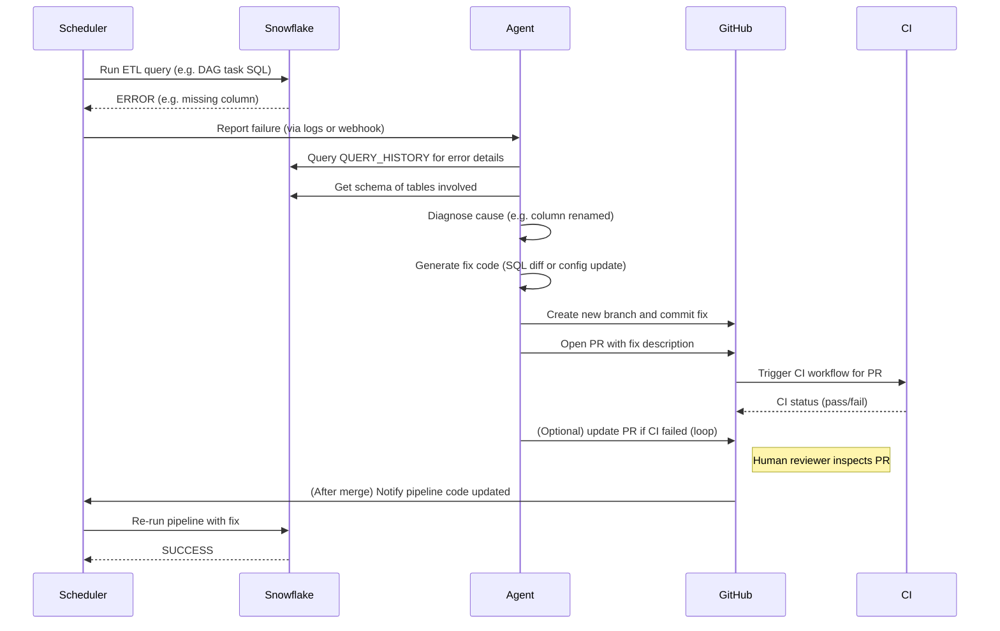
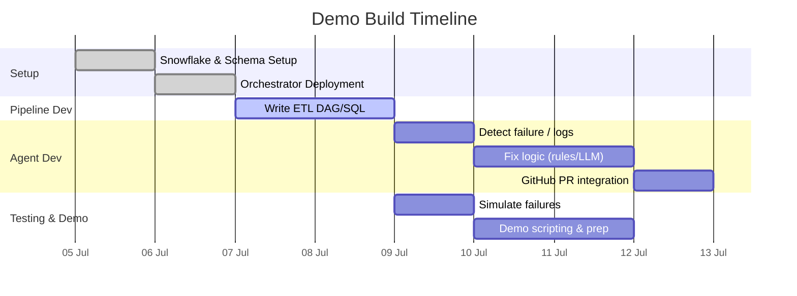

# Agentic Data Pipeline Monitoring & Auto-Remediation Demo

**Executive Summary:** We propose a demo showcasing an AI-driven **“agentic” pipeline monitor/fixer** for a Snowflake-based ETL workflow. The demo will create a minimal Snowflake data schema and a simple orchestrated pipeline (e.g. raw→processed tables) and simulate failures. An LLM-based agent monitors logs and metrics, diagnoses errors, generates code fixes (e.g. SQL queries), and raises pull requests (PRs) for automated remediation. Key success criteria include rapid detection and recovery from injected errors, automated fix proposal via PRs, and minimal manual intervention. We compare orchestration tools (Airflow, Prefect, Dagster) in terms of Snowflake support (e.g. Airflow’s SnowflakeOperator vs Dagster’s native integration). We design a sample schema (e.g. a raw sales table and an aggregated fact table) with representative data. For observability, we leverage Snowflake’s built-in **Trail** (query/copy/task history, logs in Snowsight) and integrate third-party tools (Monte Carlo, Datadog) to track data freshness, query failures, and lineage. The agent architecture follows a *detection→diagnosis→fix→PR* loop: on pipeline failure (e.g. missing column), the agent uses Snowflake error logs and query history to understand the issue, then uses rule-based or LLM-driven logic to generate a SQL fix. It commits the change in a feature branch and opens a PR via the GitHub API. The PR is integrated into CI/CD (tests/validation), with a human review step for safety. We plan failure-mode scenarios (schema drift, data format errors, null values, etc.) and demonstrate fixes (e.g. adding `COALESCE`, ALTER statements). We will include pseudocode for the agent (e.g. Python using Snowflake and GitHub APIs) and Mermaid diagrams for system flow. Safety measures include feature toggles, testing the agent logic, and Snowflake’s time-travel for data rollback. Estimated effort: ~2–4 weeks by a small team (Snowflake engineer, data engineer, DevOps), with roles and permissions (Snowflake roles, GitHub access) defined. Below we analyze each component in detail, with tables comparing options and diagrams of the proposed architecture.

## Goals & Success Metrics

- **Detection & Response:** Demo must automatically detect injected pipeline failures (e.g. SQL errors or data quality issues) via logs/alerts and trigger the agent workflow.  
- **Automated Fix & PR:** The agent should autonomously generate a code fix and open a pull request. Success means the PR contains a correct patch (SQL or DAG code) that, when merged, fixes the pipeline.  
- **Recovery Speed:** Measure *time-to-recovery* (MTTR) from failure detection to pipeline success after fix. A shorter MTTR (minutes vs hours) is a key success metric.  
- **Reliability & Coverage:** Demonstrate that for the simulated failure modes, the agent proposes fixes at a high success rate (e.g. ≥80% of errors resolved without human coding).  
- **Human Oversight:** The flow must include an approval step; success includes a clear review process. Metrics: number of fixes requiring manual edits, code review time.  
- **Demo Completeness:** The end-to-end scenario (data ingestion → transform → failure → agent fix → CI test → resume) should run smoothly without manual interruption.

*Success metrics examples:* pipeline success rate before vs after agent (goal: approach 100%), average time saved per incident (target: fix in minutes), PR acceptance rate by reviewers, and quality of fixes (no new errors introduced). We will log these metrics in the demo (e.g. timing logs, PR outcomes).

## Minimal Snowflake Schema & Sample Data

We will use a simple **star schema** (one fact table plus a dimension) for demonstration. For example, an ecommerce sales pipeline:

- **`raw_sales`** (staging): columns `(sale_id INT, user_id INT, product_id INT, qty INT, sale_date DATE)`. Loaded daily (e.g. via CSV copy).  
- **`dim_product`** (reference): `(product_id INT, name STRING, category STRING)`. Static lookup table.  
- **`sales_summary`** (aggregated): e.g. `(user_id INT, total_qty INT, last_sale DATE)`, computed from `raw_sales`.  

Sample data (small):  

| sale_id | user_id | product_id | qty | sale_date   |
|---------|---------|------------|-----|-------------|
| 1       | 100     | 200        | 2   | 2026-07-01  |
| 2       | 101     | 201        | 1   | 2026-07-01  |
| ...     | ...     | ...        | ... | ...         |

Transform logic (SQL):  
```sql
INSERT INTO sales_summary (user_id, total_qty, last_sale)
SELECT user_id, SUM(qty), MAX(sale_date)
FROM raw_sales
GROUP BY user_id;
```

We will create a minimal Snowflake database (e.g. `DEMO_DB`) and schema (`DEMO_SCHEMA`), then the above tables. This allows a reproducible pipeline where we can simulate errors (e.g. missing column in `raw_sales`) to trigger agent action. The schema can be created with simple DDL:

```sql
CREATE DATABASE IF NOT EXISTS DEMO_DB;
USE DATABASE DEMO_DB;
CREATE SCHEMA IF NOT EXISTS DEMO_SCHEMA;
CREATE TABLE DEMO_SCHEMA.raw_sales (
    sale_id INT, user_id INT, product_id INT, qty INT, sale_date DATE);
CREATE TABLE DEMO_SCHEMA.dim_product (
    product_id INT, name STRING, category STRING);
CREATE TABLE DEMO_SCHEMA.sales_summary (
    user_id INT, total_qty INT, last_sale DATE);
```

We will populate `raw_sales` and `dim_product` with a few rows. The orchestration tasks (below) will load data and run the aggregation query. A simulated error example: drop `dim_product.category` column after pipeline code is written; the transform query referencing it will fail, prompting the agent to alter the SQL or schema.

## Orchestration Tool Comparison

We compare Airflow, Prefect, Dagster (and note Snowflake Tasks) for orchestrating this pipeline. Key criteria: **Ease of Use, Snowflake Integration, Observability, Team Skill & Effort**. Table below summarizes pros/cons:

| **Orchestrator** | **Pros** | **Cons** | **Snowflake Integration** | **Effort** |
|------------------|----------|----------|--------------------------|------------|
| **Airflow**      | Ubiquitous in data teams; mature ecosystem and community; many existing operators (SnowflakeOperator). | **Snowflake is treated like any DB** – user writes SQL wrapped in operator, manual management of warehouse, tasks, credit monitoring. Can handle complex DAGs. [30]. Requires boilerplate to leverage Snowflake-native features. | Official SnowflakeOperator, good community support. But you manage Snowflake as external. Recent Airflow (v3.1) adds human-in-loop tasks (approvals). | Medium. Setting up Airflow (e.g. via Docker/Astro) takes ~1 day. Writing DAGs in Python is standard. If team already knows Airflow, ramp-up is low; otherwise plan ~1–2 days to learn. |
| **Prefect**      | Pythonic and developer-friendly; built-in Snowflake blocks/Connector; can easily run SQL and track results. Cloud and open-core versions. | Still treats Snowflake as external by default. Some Snowflake automation in v2 (e.g. SnowflakeCredentials block), but fundamentally similar to Airflow [30]. Fewer watchers/config. | Official `prefect-snowflake` integration with SnowflakeConnector to run queries or stored procs. | Low–Medium. Prefect setup is straightforward (pip install and block config). Writing flows is simple (shown in [42]), so a day to set up and learn basics. |
| **Dagster**      | **Snowflake-native asset model**. You define Snowflake-backed assets (tables/views) with dependencies. Built-in observability UI, lineage, and support for Snowflake Tasks/Streams. | More complex initial setup; steeper learning curve. Less community inertia compared to Airflow. [33] suggests best for maintainability and deep Snowflake use. | Official `dagster-snowflake` library to read/write Snowflake (see [41]). You can orchestrate both dbt and Snowflake SQL in one workflow. | Medium–High. Setting up Dagster (Docker or Dagster Cloud) and defining assets takes some time. Plan ~2 days for initial pipeline. |
| **Snowflake Tasks** | **Native** scheduler: chain SQL tasks inside Snowflake; no external infra; cost-efficient. | **Limited:** no branching logic, no external integration, no rich UI/alerts. Debugging and testing can be tricky. | **Built-in**: fully native. Use SQL (Tasks, Streams, Procedures). | Low for simple pipelines, but inflexible. If pipeline is just pure SQL and schedule, it’s easy; else, not recommended. |

 *Figure: Sample Monte Carlo comparison of Snowflake orchestration tools across criteria (Ease of Setup, UI, Snowflake integration, etc.).* From our criteria and Snowflake’s own examples, **Dagster** emerges as the most Snowflake-aware (native SnowflakeResource, asset definitions). Airflow is safe if the team already uses it, but requires more manual code. Prefect is modern and easy but similar to Airflow in approach. For the demo we recommend **Dagster** (open-source) for its clear asset model and observability. (If the team prefers one they already know, Airflow is acceptable, using the SnowflakeOperator and deferring to Snowflake tasks when possible.)

## Monitoring & Observability Stack

We will implement multi-level observability:

- **Snowflake Native Logs/Events:** Use Snowflake’s **Account Usage** views and Trail. For example, query the `SNOWFLAKE.ACCOUNT_USAGE.QUERY_HISTORY` and `TASK_HISTORY` tables to detect failed queries or missing data. Snowflake’s new *Trail* feature (Snowsight UI) consolidates logs and alerts (see Figure). We’ll enable **Logging** (user-defined function or procedure logs) so failures appear in Snowflake’s Log Explorer. Query History and Task History show failed SQLs. We can also create **Serverless Alerts** on specific failure patterns.

- **Metrics & Dashboards:** Integrate a monitoring system (e.g. Datadog or Prometheus). For example, **Datadog’s Snowflake integration** collects account/query metrics and logs. It can alert on credit spikes or failed queries. Datadog provides built-in dashboards (Snowflake overview, query perf, login events). We’ll use these to track warehouse usage and error rates. We can also leverage Snowflake’s usage views for custom alerts (e.g., credit usage over threshold).

- **Data Observability Tools:** To monitor data quality, we’ll plug in a tool like **Monte Carlo** or Bigeye. Monte Carlo’s Snowflake integration ingests table metadata, query logs, and lineage. It automatically tracks freshness, volume anomalies, schema changes, and highlights broken queries. This catches silent failures (e.g. if missing rows) that our pipeline monitoring might miss. For demo purposes, we can use their free trial or simplified open-source checks (e.g. Great Expectations).

- **Lineage & Catalog:** Snowflake’s built-in lineage (Snowsight) can trace data flows between tables. The agent can use the `GET_LINEAGE` function to programmatically find upstream objects. This helps diagnose which upstream table caused an error. We will briefly demonstrate this via a query or API call. (External lineage can also be set up if needed.)

- **Observability Summary:** The stack thus includes:
  - **Logs:** Snowflake QUERY_HISTORY, TASK_HISTORY; orchestrator logs (e.g. Airflow logs). Possibly CloudWatch or file logs if needed.
  - **Metrics:** Warehouse credit usage, query latency (via Snowflake ACCOUNT_USAGE or external).
  - **Alerts:** Snowflake Alerts, Datadog monitors.
  - **Lineage:** Snowflake UI/API lineage, Monte Carlo lineage.
  
This combination ensures the agent has rich context. For example, Monte Carlo can flag exactly which downstream tables have anomalies and link them to upstream sources, which an agent can use to prioritize fixes.

## Agent Architecture

The agent system consists of the following components:

1. **Trigger/Detection:** The agent watches for pipeline failures. Options include:
   - A webhook or callback from the orchestrator on DAG failure.
   - Polling Snowflake’s QUERY_HISTORY for recent `FAILED` queries on specific warehouses/users.
   - Polling a monitoring service (Datadog alert, or a messaging queue).
   
   For demo, we’ll implement a simple loop: check Snowflake’s `QUERY_HISTORY` every minute for errors involving our pipeline user. If a failure is found, we capture the query text and error message.

2. **Diagnosis:** Once an error is detected, the agent extracts context: error type, failing SQL, affected tables/columns. It may query Snowflake’s metadata (e.g. using `SHOW COLUMNS`) to see schema changes. It can also use the lineage API (`GET_LINEAGE`) to trace related objects. For example, if the error is “column not found: ‘family_name’”, the agent finds where the expected column should be (perhaps it has been renamed). The agent may also look at recent commits in the code repo (via GitHub API) to see if the schema or query logic was recently changed.

3. **Remediation (Fix Generation):** The agent uses rules or an LLM to propose a code fix. The strategy may be:
   - *Rule-based:* For common errors, have templates. e.g. missing column → use `ALTER TABLE ADD COLUMN` or change query column name.
   - *LLM-powered:* Pass the error message, query text, and schema info to an LLM (like GPT) with a prompt to fix the SQL or script. For example: “Given this SQL and error, correct the query to work with the current schema.” The LLM can rewrite the query or suggest a patch.
   
   In our demo, we will showcase both: a simple rule-based fix (e.g. add a missing column with default) and an LLM patch (using GPT-4o via an API call) to handle a more subtle logic fix.

4. **PR Generation:** The agent creates a **feature branch** in the pipeline’s repository and commits the fix (SQL or Python code). Using the GitHub or GitLab API, it opens a pull request. For GitHub, this uses the REST API `POST /repos/{owner}/{repo}/pulls`. We will use a Python snippet (PyGithub or `requests`) to do this. The PR title and body will reference the error and include a summary of the fix. E.g.:
   ```python
   from github import Github
   gh = Github(GITHUB_TOKEN)
   repo = gh.get_repo("org/data-pipeline")
   branch = repo.create_git_ref(ref=f"refs/heads/fix-missing-column", sha=main_sha)
   # Modify file on new branch (e.g., change SQL text)
   repo.get_contents("dags/pipeline.sql", ref=branch_name).update("Fix missing col", new_sql, branch_name)
   repo.create_pull(title="fix: handle renamed column", body="Auto-generated fix for Snowflake error.", head=branch_name, base="main")
   ```
   (Alternatively, use `requests.post` to the API endpoint.)
   
5. **CI/CD Integration:** The PR triggers the CI pipeline (e.g. GitHub Actions or Jenkins) which runs tests (unit tests or a dry-run of the pipeline). The agent monitors the CI status: if tests fail, the agent can iterate on the fix (as Datadog Bits Code does). Once CI passes, the PR is ready for review.

6. **Review & Merge:** For safety, we include a human review step. The agent can request specific reviewers (e.g. data engineer). A workflow (e.g. GitHub Actions) can block merge until approval and passing checks. Once approved, the agent or a CI action merges the PR.

7. **Deployment:** After merge, the new code is deployed (if needed). We then re-run the pipeline manually or via schedule. It should now succeed. The agent can verify success (e.g. re-check Snowflake Query History for no errors).

8. **Logging & Audit:** All agent actions are logged. We keep an audit of detected errors, generated fixes, and PR links. This ensures transparency and allows rollback if needed.

The overall interaction is illustrated in the sequence diagram below: when the pipeline job fails, the agent analyzes logs, generates a fix, and raises a PR, completing the feedback loop.



_Sequence: Pipeline fails → Agent detects & diagnoses → Agent opens PR → CI/tests → Merge → Pipeline reruns._

## Example Failure Modes & Remediation

We will simulate and handle several common failure scenarios:

- **Schema Drift (Missing/Renamed Column):**  
  *Example:* Upstream `raw_sales` schema changed (e.g. column `qty` renamed to `quantity`). The transform query referencing `qty` will error “column not found”.  
  *Agent Fix:* Detect “column `qty` not found”. Look up existing columns (Snowflake `DESC TABLE`). If a likely new column (`quantity`) exists, update the SQL to use it (or ALTER view accordingly). We can generate an SQL patch (e.g. `SELECT user_id, SUM(quantity) ...`). Pseudocode snippet:
  ```python
  if "does not exist: QUOTED identifier 'QTY'" in error_msg:
      new_sql = old_sql.replace("qty", "quantity")
      create_pr(new_sql)
  ```
- **Null/Divide Error:**  
  *Example:* A division by zero in a derived query (e.g. `AVG(qty/0)`).  
  *Agent Fix:* Catch “divide by zero” error. Modify query to use `NULLIF` or filter out zeros, e.g. `qty/NULLIF(divisor,0)`. This is more complex; agent may flag line and apply known pattern.
- **Data Quality (Missing Data):**  
  *Example:* No new rows loaded in `raw_sales` (pipeline runs on empty input). Or schema violation (date format invalid).  
  *Agent Fix:* Alert human (maybe no auto-PR). Could fill default or skip steps, but likely just notify.
- **Version or Dependency Errors:**  
  *Example:* Upstream dbt model broke SQL (syntactic bug).  
  *Agent Fix:* Possibly use LLM to correct SQL syntax. E.g. missing comma: `SELECT a b FROM` → insert comma.
- **Compute Resource Error:**  
  *Example:* Query exceeds warehouse size limit.  
  *Agent Fix:* Optionally increase warehouse size (via Snowflake API) or rewrite query to be more efficient (LLM-based suggestion). Less common for demo.
- **Snowflake Task Failure:**  
  *Example:* A chain of Snowflake Tasks fails on intermediate result.  
  *Agent Fix:* Query TASK_HISTORY for error, then fix the underlying SQL as above.

For each simulated error, we will run the pipeline, let the agent detect it, and observe the PR. For instance, to simulate the first mode, we can alter the schema mid-demo:
```sql
ALTER TABLE DEMO_SCHEMA.raw_sales RENAME COLUMN qty TO quantity;
``` 
This causes the existing DAG’s INSERT query to fail. The agent will log the error:
“SQL compilation error: error line 3 at position 15: invalid identifier 'qty'”  
Agent resolution: swap `qty`→`quantity` in code, open PR with the fix.

Another example: add an unexpected extra column to input, causing mismatch. The agent could handle by adjusting `SELECT * EXCEPT` or explicitly listing needed columns.

## Code Snippets & Logic

**Agent Logic Pseudocode (Python):**

```python
import snowflake.connector
import time
import re
from github import Github

# Configuration
SNOWFLAKE_CONN = {...}
GITHUB_TOKEN = "ghp_..."
REPO = "org/data-pipeline"
ERROR_PATTERN = r"column '(.+)' does not exist"

def detect_and_fix():
    while True:
        # 1. Check for recent failures in Query History
        query = """
          SELECT query_text, error_message
          FROM DEMO_DB.INFORMATION_SCHEMA.QUERY_HISTORY
          WHERE status = 'FAILED' AND start_time > (CURRENT_TIMESTAMP - INTERVAL '5 MINUTES')
        """
        cs = cnx.cursor().execute(query)
        for row in cs:
            sql_text, error = row
            m = re.search(ERROR_PATTERN, error)
            if m:
                missing = m.group(1)
                fix_missing_column(sql_text, missing)
        time.sleep(60)

def fix_missing_column(sql_text, missing_col):
    # Example fix: find plausible replacement
    cs = cnx.cursor().execute(f"DESC TABLE DEMO_DB.DEMO_SCHEMA.raw_sales")
    columns = [row[0].lower() for row in cs]
    for col in columns:
        if missing_col.lower() in col:
            new_col = col
            break
    else:
        new_col = None
    if new_col:
        new_sql = sql_text.replace(missing_col, new_col)
        create_pr_with_fix(new_sql)

def create_pr_with_fix(patched_sql):
    gh = Github(GITHUB_TOKEN)
    repo = gh.get_repo(REPO)
    base = repo.get_branch("main")
    new_branch = repo.create_git_ref(ref="refs/heads/fix-missing-col", sha=base.commit.sha)
    # Assume pipeline SQL is in file pipeline.sql
    content_file = repo.get_contents("pipeline.sql", ref=new_branch.ref)
    repo.update_file(content_file.path, "Auto-fix missing column", patched_sql, content_file.sha, branch=new_branch.ref)
    repo.create_pull(title="fix: resolve missing column error", 
                     body="Automatically fixed missing column in SQL", 
                     head=new_branch.ref, base="main")
```

*Note:* Actual implementation would handle more cases and include error handling. The code above demonstrates using Snowflake Python connector for detection and PyGithub for PR creation (GitHub REST API is documented).

**SQL Fix Example:**  
Original failing query:
```sql
-- original pipeline code
INSERT INTO DEMO_SCHEMA.sales_summary (user_id, total_qty, last_sale)
SELECT user_id, SUM(qty), MAX(sale_date)
FROM DEMO_SCHEMA.raw_sales
GROUP BY user_id;
```
Error: column `qty` does not exist (renamed to `quantity`).  
Patched query:
```sql
INSERT INTO DEMO_SCHEMA.sales_summary (user_id, total_qty, last_sale)
SELECT user_id, SUM(quantity) AS total_qty, MAX(sale_date) AS last_sale
FROM DEMO_SCHEMA.raw_sales
GROUP BY user_id;
```

**Automated PR (GitHub) Example:** Using `requests`:
```python
import requests

pr_data = {
  "title": "fix: rename qty column to quantity",
  "head": "fix-missing-col",
  "base": "main",
  "body": "Auto-generated PR: replace qty with quantity.",
}
headers = {"Authorization": f"token {GITHUB_TOKEN}"}
resp = requests.post(
    "https://api.github.com/repos/org/data-pipeline/pulls",
    json=pr_data, headers=headers
)
```
This calls GitHub’s Pulls API.

## End-to-End Demo Flow & Scripts

The live demo will follow these steps (with scripts/commands):

1. **Setup (one-time):**  
   - Provision Snowflake dev account (or use existing). Create database, schema, tables as above (with sample data).  
   - Deploy orchestrator (e.g. launch an Airflow or Dagster instance via Docker). Configure connection to Snowflake (credentials stored as secrets).  
   - Place pipeline code and infrastructure-as-code (Terraform or Docker Compose) in a GitHub repo.  
   - Set up GitHub Actions (or equivalent CI) to run pipeline tests.

2. **Run Pipeline (baseline):**  
   Execute the pipeline via orchestrator (e.g. trigger DAG). Confirm it succeeds (populates `sales_summary`). Show logs/metrics.

3. **Inject Failure:**  
   Change Snowflake schema to cause a failure. Example SQL (in Snowflake UI or via script):
   ```sql
   ALTER TABLE DEMO_SCHEMA.raw_sales RENAME COLUMN qty TO quantity;
   ```
   This makes the next run of the pipeline fail.

4. **Trigger Pipeline Again:**  
   Invoke the pipeline. It will error (e.g. shown in orchestrator UI or query history). Example error log will display “column qty does not exist”.

5. **Agent Detects Failure:**  
   Show agent’s log/console: it polls and sees the failed query. It prints the detected error and failing SQL.

6. **Agent Generates Fix & Opens PR:**  
   The agent processes the error, updates the SQL, and calls the GitHub API. Demonstrate the newly created branch and PR in the repo (possibly using GitHub CLI or web UI). Show PR title and diff (only changed `qty` → `quantity`). For more complex fix, show commit diff.

7. **CI Runs Tests:**  
   The PR triggers CI (e.g. a workflow that executes the pipeline against a test table). Show CI status passing. The agent might iterate if CI had failed initially (for this demo, assume one attempt).

8. **Human Review & Merge:**  
   A team member reviews the PR via GitHub UI and clicks “Merge”. (We may simulate this or do live.)

9. **Pipeline Re-Run:**  
   The updated code is now on `main`. Rerun the pipeline. It should succeed. Show final state of `sales_summary`.

10. **Verification:**  
    Show that the agent logged the fix, the error is resolved, and metrics (e.g. pipeline run time) are back to normal. Possibly rerun the pipeline a third time to ensure stability.

Throughout the demo, we will run shell commands/scripts for the orchestrator (e.g. `dagster job execute`, or Airflow CLI trigger), Snowflake (using SnowSQL), and agent (Python script or service). These can be prepared as a short script to sequentially run each step. This script might simply pause for human actions (like PR review) or simulate it for automated run.

## Safety, Testing & Rollback

To ensure the demo is safe and repeatable:

- **Branch Isolation:** The agent always works on feature branches and PRs. It never commits directly to `main`. This prevents unvetted changes reaching production. Only merged PRs apply fixes.
- **Approval Workflow:** Require at least one human review in CI (GitHub branch protection) before merge. The agent’s PR is draft or requires review. This is our human-in-the-loop safety control.
- **Testing:** Include unit tests for pipeline code (if applicable) and simulate data quality tests (e.g. assert that `sales_summary` has no null keys). The CI run will execute these tests. The agent should re-run failed tests after updating code (like Datadog Bits Code does).
- **Logging:** The agent logs all actions (printouts or log file). We will capture its reasoning (if LLM is used, the prompts and outputs). These logs can be reviewed to ensure no malicious or erroneous changes.
- **Rollback Mechanism:** 
   - **Snowflake Time Travel:** If the agent’s fix somehow corrupts data, we can use Snowflake’s time travel to revert tables to a previous state (Snowflake supports querying historical data up to defined retention period).  
   - **Git Revert:** If a PR merge introduced an issue, it can be reverted with a follow-up commit. We can demonstrate this as a safety net.  
   - **Blue/Green/Test Environment:** Ideally, apply fixes to a staging pipeline first (for the demo, running the pipeline in a “dev” schema or sandbox), then promote to production if all checks pass.
- **Controlled Inputs:** We will disable the agent when not needed, and ensure it only responds to designated pipeline contexts (e.g. watches only DEMO_DB queries).
- **Rate Limiting:** Agent operations (API calls to GitHub/Snowflake) should be rate-limited. Secrets (API keys) are stored securely (not in code). 
- **Monitoring Agent:** We will monitor the agent itself (is it running? error logs?). If the agent crashes, manual fallback (the team can still fix errors).

By enforcing these controls and thoroughly testing the demo pipeline (both the code and the agent logic), we ensure the system does not cause unintended damage. The rollback and test steps serve both as safety and as part of the demo narrative.

## Resources, Timeline & Team

**Estimated Effort:** Building this demo end-to-end is a moderate project. Rough breakdown (assuming a small team of 2–3 engineers):

- **Day 1–2:**  
  - Define sample schema and generate test data.  
  - Provision Snowflake account, set up roles.  
  - Set up orchestration environment (e.g. Airflow or Dagster via Docker).  
  - Skeleton pipeline code (Python or SQL DAG) and Git repo.  

- **Day 3–4:**  
  - Implement pipeline tasks (data load, transform).  
  - Write and test pipeline without agent.  
  - Connect orchestrator to Snowflake, run end-to-end.  

- **Day 5–6:**  
  - Build monitoring: configure Snowflake QUERY_HISTORY checks; integrate Datadog or log queries.  
  - Develop agent “skeleton”: detect errors, simple rule-based fixes.  
  - Write first agent-based fix (e.g. missing column).  

- **Day 7–8:**  
  - Integrate GitHub: set up repo, CI (Actions) tests, and agent’s PR creation logic.  
  - Test agent fix with CI loop.  
  - Add additional fixes (LLM or more complex).  

- **Day 9–10:**  
  - Script the demo flow, polish logs and outputs.  
  - Prepare failure scenarios and test each (schema drift, nulls, etc).  
  - Add error handling, make agent loop robust.  
  - Setup human review simulation.  

- **Day 11–12:**  
  - Write documentation and slides for demo.  
  - Rehearse the demo end-to-end.  
  - Buffer time for troubleshooting.

Total ~2 weeks of active development plus 1 week of testing/revisions (3 weeks in total). If parallelized, a small team (1 data engineer, 1 ML/agent engineer, part-time DevOps) could finish in ~2–3 weeks.

**Team Roles & Permissions:**  
- **Snowflake/Data Engineer:** Needs a role with CREATE, SELECT, INSERT privileges on DEMO_DB. Likely a custom role (e.g. `DEMO_ETL_ROLE`) or higher (SYSADMIN) for setup. Manages database objects and provides credentials to the orchestrator/agent service.  
- **Git/Repo Admin:** A developer with write and branch protection admin on the GitHub repo. Creates service token for the agent with scope to read/write code and create PRs. Also sets up CI secrets and environment (e.g. sets `GITHUB_TOKEN` in CI).  
- **CI Administrator:** Sets up GitHub Actions (or other CI) with permissions to run pipeline tests. Possibly the same person as Git admin.  
- **Agent Service Account:** The agent can use the Snowflake credentials (same as Data Engineer or a dedicated limited user) to query logs. It uses a GitHub PAT with repo scope to create branches/PRs. This account should have no more rights than necessary (write to specific repo only).  
- **Reviewers:** A senior engineer (data architect or data engineer lead) who reviews agent-generated PRs. Should have ability to approve/merge.  
- **Stakeholders:** A product owner or data manager who defines success criteria (not hands-on during demo, but audience).

**Permissions Table:**

| **Role/Person**         | **Snowflake Privileges**      | **GitHub Permissions**           | **CI**        |
|-------------------------|------------------------------|----------------------------------|---------------|
| Data Engineer           | OWNERSHIP/CREATE on demo DB, usage on warehouses | Write access to repo (code/branch) | Can run pipelines/test jobs |
| Orchestration Service   | USAGE on warehouse, SELECT/INSERT on tables  | None (executes code)            | —             |
| Agent (service user)    | SELECT on QUERY_HISTORY, USAGE on warehouse, minimal DML on tables (if altering) | **Token with repo write+pull rights** | — |
| CI Runner               | USAGE on warehouse, needed DDL/DML (running pipeline) | Read/PR access (via token)      | Administer CI config |
| Reviewer (Engineer)     | USAGE on DB (view objects)   | Write + approve rights on repo   | N/A (review stage) |
| Admin (IT/Sec)          | SYSADMIN on Snowflake (for setup) | Admin on GitHub (for initial setup) | Administer CI setup |

These roles ensure least privilege. The agent’s Snowflake role only needs to read logs and modify code (if it would auto-ALTER tables, we’d give it extra rights, but we can do all fixes via code instead). The GitHub PAT used by the agent should be scoped tightly (repo-level).

**Assumptions:**  
We assume a cloud environment (AWS/Azure/GCP) where we can run an orchestrator and agent service (e.g. Kubernetes or simple VM). For simplicity, we may use Docker on a laptop or CI runner. We assume Snowflake version supports Snowsight and Trails (features generally available in 2026). We assume no existing complex pipelines; this is a greenfield demo. We also assume using GitHub, but analogous steps apply to GitLab. No corporate firewall issues. The orchestrator and agent services have internet access to call Snowflake and GitHub APIs. Secrets (Snowflake credentials, GitHub token, OpenAI API key if used) are stored securely (e.g. environment variables or secret manager). We assume compliance with any regulatory constraints (demo uses dummy data only).

## Comparative Tables

**Orchestration Tools (Airflow vs Prefect vs Dagster):** Summarized above. Key: Dagster’s asset-aware model and native SnowflakeResource vs Airflow/Prefect’s general SQL-run approach.

**Observability Tools:**  

| **Tool/Category**        | **Focus**      | **Snowflake Integration**                  | **Pros**                                        | **Cons**                                  | **Effort**   |
|--------------------------|----------------|-------------------------------------------|-------------------------------------------------|-------------------------------------------|--------------|
| **Snowflake Trail (native)** | Logs/Metrics  | Built-in Query/Copy/Task History; Snowsight UI | No extra cost; deep integration; lineage view | Less flexible alerting; requires Snowflake account SKU | Low (enable logs) |
| **Datadog (Monitoring)** | Metrics/Logs   | Pulls from SNOWFLAKE.ACCOUNT_USAGE tables | Out-of-the-box dashboards; alerts; can correlate infra metrics | Snowflake queries bill credits; external tool licensing | Medium (connect Snowflake, configure dashboards) |
| **Monte Carlo (Observ.)** | Data Observ.  | Connects to Snowflake metadata & logs  | Automated data health monitors (freshness, schema, lineage) | Commercial (licensed), may be heavy for small demo    | High (sign-up+config) or trial use |
| **Bigeye (Observ.)**      | Data Observ.  | Similar to Monte Carlo (focus on data quality/lineage) | AI-driven anomaly detection, easy setup with Snowflake** | Commercial, additional cost           | High (setup/ config) |
| **Custom (Open Source)** | Customized    | E.g. Great Expectations for data tests, OpenTelemetry | No extra cost; flexible; local control           | Requires development of tests; no end-to-end UI      | Medium (dev tests) |

Tables emphasize trade-offs: built-in Snowflake logs vs external SaaS. For a demo, Snowflake’s Query/Copy history and a simple open-source dashboard (Grafana) might suffice. But we will mention Datadog/Monte Carlo as realistic options.

**AI Agent Frameworks:**  

| **Framework/Tool**        | **Type**            | **Integration**                  | **Pros**                                        | **Cons**                                            | **Effort**    |
|---------------------------|---------------------|----------------------------------|-------------------------------------------------|-----------------------------------------------------|---------------|
| **GitHub Copilot Autofix** | GitHub Security (CodeQL) | Built into GitHub            | Automatically fixes CodeQL security alerts; fast | Only for vulnerabilities; no pipeline logic        | Low (enabled on repo) |
| **OpenAI Agent SDK**      | LLM agent API       | Programmatic (OpenAI)            | Supports custom agent loops; fine-grained control | Under development; requires LLM prompts design      | High (framework learning) |
| **LangChain (OpenAI)**    | LLM chain toolkit   | Python (can call APIs, tools)   | Flexible custom agents; large community | Complexity; hidden prompt logic; maintenance effort | High |
| **Datadog Bits Code**     | Managed APM feature | Datadog integration | Hands-off fix generation; telemetry context | Part of Datadog enterprise; black-box            | Low (if Datadog used) |
| **AutoGPT / AutoGen**     | Multi-agent framework| General LLM                      | Fully autonomous, iterative trials             | Immature; risk of runaway loops; monitoring needed | Medium–High (setup) |

This table is illustrative. In practice, we might implement a simple in-house agent (Python script + GPT calls) rather than a full framework. LangChain and similar libraries are often used to orchestrate LLM reasoning. For this demo, we’ll code the agent “manually” (as above) but note that frameworks like LangChain (and its extensions like LangGraph) could be used to structure the agent’s multi-step reasoning. GitHub and Datadog offer built-in auto-fix features (Copilot Autofix, Bits Code) that are analogous products in this space.

## Mermaid Diagrams

**Pipeline & Agent Sequence:** (as shown above)  

**Development Timeline (Gantt):** Planning tasks and estimated durations:


This timeline assumes starting on July 5, 2026. The **Sales pipeline DAG** and agent logic are developed early, followed by integration tasks and final rehearsal.

## References

We relied on authoritative sources:

- **Snowflake Documentation:** For lineage and observability (Snowflake Trail).  
- **Snowflake Blog:** “Observability… with Snowflake Trail” outlines using Query History, Event Tables, and Alerts as telemetry.  
- **Monte Carlo & Datadog Docs:** Monte Carlo’s Snowflake integration (data quality, lineage); Datadog’s Snowflake integration (metrics, logs).  
- **Airflow 3.1 Release Notes:** Human-in-loop operators introduced.  
- **Monte Carlo Blog:** Comparative analysis of Snowflake orchestration tools.  
- **Agentic CI/CD:** Datadog Bits Code example of auto-fixing via PRs; pattern of *Detection→Diagnosis→Fix→Deploy*.  
- **Research:** LLM-based remediation (LLM-ARF) describes a detection-diagnosis-remediation loop with human-in-loop.  
- **Prefect & Dagster Docs:** Integration examples (Dagster’s SnowflakeResource; Prefect’s SnowflakeConnector example).  
- **GitHub API:** Pull request creation endpoint reference.

All these sources inform the design choices, tool comparisons, and architecture presented above. 

