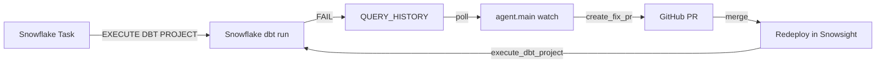

# Data Pipeline Auto-Healer Agent Demo

AI-driven pipeline monitor and fixer for a **Snowflake + dbt** ecommerce ETL demo. A Claude Agent SDK agent detects failures, diagnoses root cause, opens GitHub PRs with fixes, and supports human-in-the-loop merge before re-running dbt.

## Architecture

```
pipeline/dbt/   → dbt project (models, sources, profiles.yml)
pipeline/sql/   → Snowflake DDL + failure injection SQL
pipeline/data/  → CSV seed data
agent/          → Claude Agent SDK watcher, MCP tools, safety hooks
demo/           → Playwright setup + interactive demo runner
```

## Prerequisites

- Python 3.10+
- dbt Core + dbt-snowflake (`pip install dbt-snowflake`)
- Snowflake account with user `DATAAGENT`
- GitHub PAT (`repo` scope) and Anthropic API key (for full agent)

## One-time setup

```powershell
python -m venv .venv
.venv\Scripts\activate
pip install -r requirements.txt
copy .env.example .env
# Fill SNOWFLAKE_PASSWORD, GITHUB_TOKEN, ANTHROPIC_API_KEY
python pipeline/scripts/setup_all.py
```

`setup_all.py` creates schema, seeds data, runs `dbt run --select sales_summary`, and verifies rows in Snowflake.

### Playwright (optional — capture Snowflake account)

```powershell
cd demo
npm install
npm run setup:snowflake
```

## Run the pipeline

```powershell
python pipeline/scripts/run_pipeline.py --expect success
```

Equivalent to:

```powershell
cd pipeline/dbt
set DBT_PROFILES_DIR=.
dbt run --select sales_summary
```

## Demo scenarios

| # | Scenario | Injection | Agent fix (PR to dbt model) |
|---|----------|-----------|---------------------------|
| 1 | Schema drift | Renames `qty` → `quantity` in Snowflake | Updates `sum(qty)` → `sum(quantity)` in model |
| 2 | Divide by zero | Broken model with `/ (user_id - 100)` | Adds `nullif(..., 0)` |
| 3 | SQL syntax | Missing comma in SELECT | Fixes SQL syntax |

### Full interactive demo

```powershell
python demo/run_demo.py --scenario 1
```

### Agent

The watcher ignores failures from before agent start. Only new failures after `watch` begins trigger healing.

```powershell
python -m agent.main watch-multi          # poll ALL registered pipelines
python -m agent.main watch-multi --rules-only
python -m agent.main heal-once
python -m agent.main list-failures
```

Register pipelines via the **dashboard** (recommended) or edit `data/pipelines.csv` directly.

## Admin Dashboard (Streamlit)

Futuristic web UI for pipeline management, KPIs, and agent control.

```powershell
pip install -r requirements.txt
# Set ADMIN_USERNAME and ADMIN_PASSWORD in .env
python -m streamlit run dashboard/app.py
```

If `streamlit` is not on PATH, always use `python -m streamlit run ...` instead.

Default login: `admin` / `admin` (change `ADMIN_PASSWORD` in `.env`).

| Page | Features |
|------|----------|
| **Dashboard** | Tracked pipelines, open failures, PRs opened, deployed fixes, avg time-to-PR, green/red status |
| **Pipelines** | Add dbt pipeline (name, DB, schema, GitHub URL, model path), test connection, save |
| **Agent Control** | Start/stop multi-pipeline watcher, view filtered chat logs (user/assistant text only) |

Dashboard data is stored in `data/incidents.csv` and `data/pipelines.csv`.

Set in `.env`:

```env
GITHUB_REPO=bedirachit/snowflake-sales-aggregate-dbt
DBT_PROJECT_OBJECT=DEMO_DB.DEMO_SCHEMA.SNOWFLAKES_SALES
```

The watcher polls `DBT_PROJECT_EXECUTION_HISTORY` for each registered pipeline.

## Periodic dbt runs (Snowflake)

After deploying the dbt project in Snowsight, schedule it with a **Snowflake Task**:

```sql
-- See pipeline/sql/snowflake/schedule_dbt_task.sql
CREATE OR ALTER TASK run_sales_dbt
  WAREHOUSE = COMPUTE_WH
  SCHEDULE = '6 HOUR'
AS
  EXECUTE DBT PROJECT DEMO_DB.DEMO_SCHEMA.demo_sales_etl
    ARGS = 'run --select sales_summary --target dev';

ALTER TASK run_sales_dbt RESUME;
```

Replace `demo_sales_etl` with the name from `SHOW DBT PROJECTS IN SCHEMA DEMO_DB.DEMO_SCHEMA`.

Alternatively use Snowsight: **Data** → **dbt Projects** → your project → **Schedule a dbt run**.

## End-to-end flow



1. Task runs dbt on schedule → failure lands in query history.
2. Agent detects failure → opens PR on [snowflake-sales-aggregate-dbt](https://github.com/bedirachit/snowflake-sales-aggregate-dbt).
3. You merge the PR → pull latest into Snowflake dbt workspace and redeploy.
4. Agent or manual `EXECUTE DBT PROJECT` verifies the fix.

## PR target (GitHub repo for fixes)

PRs go to **https://github.com/bedirachit/snowflake-sales-aggregate-dbt** — not this agent repo.

The agent patches:

- `pipeline/dbt/models/marts/sales_summary.sql` (in that repo)

This monorepo keeps a copy under [`pipeline/dbt/`](pipeline/dbt/) for local dev and demo injection scripts.

## Agent MCP tools (Claude mode)

Detection is handled by the watcher — the agent receives the error in its prompt.

- `describe_table`, `get_lineage` — Snowflake read-only diagnosis
- `create_fix_pr` — open fix PR on GitHub

The agent cannot run dbt, execute SQL, or browse the repo. Current model SQL is passed in the prompt.

## profiles.yml — important (Snowsight vs local)

Snowflake **native dbt workspace does NOT support** `{{ env_var(...) }}` in `profiles.yml`.  
If you see:

`Role {{ env_var('SNOWFLAKE_ROLE', 'ACCOUNTADMIN') }} does not exist`

use **literal values** in the Git repo that Snowflake reads:

```yaml
# pipeline/dbt/profiles.yml  (for Snowsight / Snowflake dbt Projects)
demo_sales_etl:
  target: dev
  outputs:
    dev:
      type: snowflake
      account: "snowflake"
      user: "snowflake"
      password: "snowflake"
      role: ACCOUNTADMIN
      database: DEMO_DB
      warehouse: COMPUTE_WH
      schema: DEMO_SCHEMA
```

Local CLI runs use [`pipeline/dbt_local/profiles.yml`](pipeline/dbt_local/profiles.yml) with `env_var` (via `.env`).

Also ensure `dbt_project.yml` **name** uses underscores only (e.g. `demo_sales_etl`, not `snowflake-sales-aggregate-dbt`).


```sql
SELECT * FROM DEMO_DB.DEMO_SCHEMA.sales_summary ORDER BY user_id;
SELECT COUNT(*) FROM DEMO_DB.DEMO_SCHEMA.raw_sales;
```

## Rollback

```powershell
python pipeline/scripts/reset_baseline.py
git revert <merge-commit>
```
