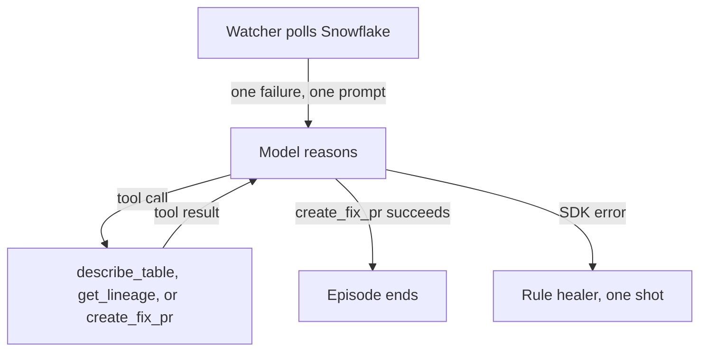
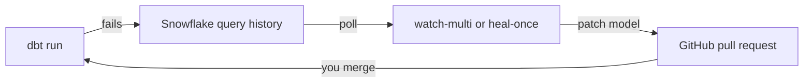

# Data Pipeline Auto-Healer Agent

Watches a Snowflake + dbt sales pipeline, diagnoses a failed run, and opens a GitHub pull request with a model fix. You merge the pull request. The agent does not merge or redeploy for you.

Every command below is run from the repository root with the virtual environment activated.

## Run it

### 1. Install

```powershell
python -m venv .venv
.venv\Scripts\activate
pip install -r requirements.txt
copy .env.example .env
```

`pip install` puts `dbt` on the virtualenv path. If a later command says `dbt` is not recognized, the virtualenv is not active.

### 2. Fill in `.env`

Open `.env` and set these before anything else:

```env
SNOWFLAKE_ACCOUNT=your_account_identifier
SNOWFLAKE_USER=DATAAGENT
SNOWFLAKE_PASSWORD=your_password
GITHUB_TOKEN=github_pat_...
ANTHROPIC_API_KEY=sk-ant-...
```

`SNOWFLAKE_ACCOUNT` is the identifier in your Snowflake URL (`https://<account>.snowflakecomputing.com`), not the vanity URL. The other Snowflake settings in `.env.example` already match this demo (`COMPUTE_WH`, `ACCOUNTADMIN`, `DEMO_DB`, `DEMO_SCHEMA`).

`GITHUB_TOKEN` needs access to the pipeline repo in `GITHUB_REPO` (contents and pull requests). `ANTHROPIC_API_KEY` is used by the Claude agent. If that call fails, the rule-based healer still opens the pull request, as long as `GITHUB_TOKEN` is set.

Leave `ADMIN_USERNAME` / `ADMIN_PASSWORD` as `admin` / `admin` until you open the dashboard. Change the password before anyone else can reach it.

### 3. Create the Snowflake demo and prove dbt works

```powershell
python pipeline/scripts/setup_all.py
```

This creates `DEMO_DB.DEMO_SCHEMA`, loads the CSVs, runs `sales_summary`, and checks both tables have rows. It is done when you see `Setup complete — dbt pipeline validated.`

Check in Snowflake:

```sql
SELECT * FROM DEMO_DB.DEMO_SCHEMA.sales_summary ORDER BY user_id;
```

### 4. Run Streamlit

Start the dashboard from the repo root, with the virtualenv still active:

```powershell
python -m streamlit run dashboard/app.py
```

Use `python -m streamlit` so this works even when the `streamlit` command is not on your PATH.

Streamlit prints a local URL. Open it in a browser. It is usually:

```text
http://localhost:8501
```

Sign in with the values from `.env`. The sample file uses:

```text
username: admin
password: admin
```

Leave this terminal running. The app stops when you press Ctrl+C.

| Page | Use it to |
|---|---|
| Dashboard | See open failures, pull requests, and time-to-PR |
| Pipelines | Register a dbt project. Test connection, then Save |
| Agent | Start or stop the watcher, and read its log |

Pipeline form for this demo:

| Field | Value |
|---|---|
| DBT Project Name | `SNOWFLAKES_SALES` |
| Snowflake Database | `DEMO_DB` |
| Snowflake Schema | `DEMO_SCHEMA` |
| GitHub Repo URL | `https://github.com/bedirachit/snowflake-sales-aggregate-dbt` |
| Model File Path | `pipeline/dbt/models/marts/sales_summary.sql` |

Click **Test Connection**, then **Save**. On the Agent page, click start. The watcher only reacts to failures that happen after it starts, so inject the failure from a second terminal (step 6) after the agent is running.

### 5. Break the pipeline and let the agent open a pull request

One command runs the whole demo. It resets the baseline, injects a failure, runs dbt so it fails, then calls the healer:

```powershell
python demo/run_demo.py --scenario 1
```

| `--scenario` | What breaks | What the pull request changes |
|---|---|---|
| `1` | Renames column `qty` to `quantity` | `sum(qty)` becomes `sum(quantity)` |
| `2` | Divides by `(user_id - 100)`, which is 0 for user 100 | Wraps the divisor in `nullif(..., 0)` |
| `3` | Drops the comma after `user_id` | Puts the comma back |

The script pauses with `After merging PR, press Enter to re-run dbt...`. Open the pull request URL printed just above that line, merge it, pull the model back into this repo if you want the local file updated, then press Enter. The last step runs dbt again and expects success.

Scenario 1 changes the Snowflake column. After that demo, put the column and model back:

```powershell
python pipeline/scripts/reset_baseline.py
```

### Same demo, one step at a time

Use this when you want to see each stage instead of `run_demo.py`.

```powershell
python pipeline/scripts/reset_baseline.py
python pipeline/scripts/run_pipeline.py --expect success
python pipeline/scripts/inject_schema_drift.py
python pipeline/scripts/run_pipeline.py --expect failed
python -m agent.main heal-once
```

`heal-once` looks at failures from the last two hours and opens one pull request. A successful run prints a result dict that includes the pull request URL. `No recent failures found` means dbt did not fail, or the failure is older than two hours.

`run_pipeline.py --expect failed` exits 0 when dbt fails. That is the point of `--expect failed`.

Swap the inject script for the other scenarios:

```powershell
python pipeline/scripts/inject_divide_by_zero.py
python pipeline/scripts/inject_sql_syntax.py
```

### 6. Leave the agent running

`heal-once` handles one failure and exits. To keep watching, start the watcher **before** you inject the next failure. It ignores failures that already exist.

```powershell
python -m agent.main watch-multi
```

In a second terminal (same virtualenv, same repo root):

```powershell
python pipeline/scripts/inject_sql_syntax.py
python pipeline/scripts/run_pipeline.py --expect failed
```

The first terminal logs `New failure` and then `PR opened`. Stop the watcher with Ctrl+C.

`watch-multi` reads `data/pipelines.csv`. The first time any agent command runs, that file is created with one pipeline from `.env`:

| Field | Default |
|---|---|
| dbt project name | last part of `DBT_PROJECT_OBJECT` (`SNOWFLAKES_SALES`) |
| database / schema | `DEMO_DB` / `DEMO_SCHEMA` |
| GitHub repo | `GITHUB_REPO` |
| model file | `pipeline/dbt/models/marts/sales_summary.sql` |

Other commands:

```powershell
python -m agent.main list-failures   # failures from the last two hours; does not heal
python -m agent.main watch           # one project, using DBT_PROJECT_OBJECT only
```

## Agent pattern

The healer that talks to Claude is a **ReAct** loop: reason, act with a tool, observe the tool result, and repeat until the task is done. This repo does not parse `Thought:` / `Action:` text itself. `ClaudeSDKClient` in `agent/agent_runner.py` runs that loop. Each model turn can include reasoning and a tool call. The SDK executes the tool and feeds the result back as the next observation.

One failure is one episode. The watcher is not part of the loop. It only polls Snowflake and starts the episode with the error and the current model SQL. The system prompt then asks the model to diagnose, patch, and open one pull request.



A typical episode looks like this:

1. **Reason.** The error names a missing column, a divide-by-zero, or a syntax error.
2. **Act.** Call `describe_table` on `raw_sales`.
3. **Observe.** The live column list comes back. `get_lineage` is optional.
4. **Reason.** Decide the SQL edit from that schema and the model already in the prompt.
5. **Act.** Call `create_fix_pr` with the patched file. Hooks reject the call unless the branch starts with `auto-heal/` and the pull request body cites the incident id.
6. **Stop.** The model has no further tool call. A person merges the pull request. There is no second agent and no automatic retry.

If the Claude call throws, `heal_with_rules` runs once. That path is not ReAct. It matches the error with regular expressions (renamed column, divide by zero, missing comma) and opens the pull request directly.

## What the agent is allowed to do

The watcher finds the failure and passes the error plus the current model SQL to the healer. The healer may call:

| Tool | What it does |
|---|---|
| `describe_table` | Read Snowflake column names |
| `get_lineage` | Read upstream tables |
| `create_fix_pr` | Push an `auto-heal/` branch and open a pull request |

It does not run dbt, execute SQL, or merge. Tool calls are appended to `agent/audit/incidents.jsonl`.

## How a failure gets to the agent



Local `run_pipeline.py` is enough for the demo. The agent also sees failures from a dbt project deployed in Snowflake (`EXECUTE DBT PROJECT`). That path is optional and is described under [Schedule runs in Snowflake](#schedule-runs-in-snowflake).

Pull requests go to the GitHub repo on the pipeline, not to this agent repo. This repo is the agent, the dashboard, and the local dbt project used by the scripts.

## Schedule runs in Snowflake

Skip this for the local demo. Use it when the dbt project is deployed in Snowsight and a task should run it.

Snowflake's dbt workspace does not expand `{{ env_var(...) }}`. The profile it reads is `pipeline/dbt/profiles.yml`, which uses literal values. Local scripts use `pipeline/dbt_local/profiles.yml`, which reads `.env`. The project name in `dbt_project.yml` must stay `demo_sales_etl` (underscores only).

After deploy, confirm the object name:

```sql
SHOW DBT PROJECTS IN SCHEMA DEMO_DB.DEMO_SCHEMA;
```

Then schedule it (`pipeline/sql/snowflake/schedule_dbt_task.sql`):

```sql
CREATE OR ALTER TASK run_sales_dbt
  WAREHOUSE = COMPUTE_WH
  SCHEDULE = '6 HOUR'
AS
  EXECUTE DBT PROJECT DEMO_DB.DEMO_SCHEMA.SNOWFLAKES_SALES
    ARGS = 'run --select sales_summary --target dev';

ALTER TASK run_sales_dbt RESUME;
```

Replace `SNOWFLAKES_SALES` with the name from `SHOW DBT PROJECTS`. Set `DBT_PROJECT_OBJECT` in `.env` to that same `database.schema.name`.

## If a command fails

| What you see | What to do |
|---|---|
| `SNOWFLAKE_ACCOUNT is empty` | Set it in `.env`, then run the command again from the repo root |
| `dbt` is not recognized | Activate `.venv` and rerun |
| `dbt run failed` during `setup_all.py` | Check warehouse, role, and password. The user needs to create `DEMO_DB` |
| `No recent failures found` | Run an inject script, then `run_pipeline.py --expect failed`, then `heal-once` |
| Watcher is running but nothing happens | It ignores old failures. Inject and rerun dbt **after** the watcher starts |
| Agent logs a Claude error, then continues | Expected fallback. A pull request still opens when `GITHUB_TOKEN` is valid |
| Login to the dashboard fails | Username and password are `ADMIN_USERNAME` and `ADMIN_PASSWORD` in `.env` |
| `streamlit` is not recognized | Run `python -m streamlit run dashboard/app.py` from the repo root with the virtualenv active |

## Tests

```powershell
pytest pipeline/tests -q
```

## Layout

| Path | Purpose |
|---|---|
| `agent/` | Watcher, Claude agent, rule-based fallback, GitHub and Snowflake tools |
| `dashboard/` | Streamlit UI |
| `pipeline/dbt/` | dbt project, including the Snowsight `profiles.yml` |
| `pipeline/dbt_local/` | Local dbt profile that reads `.env` |
| `pipeline/scripts/` | Setup, seed, dbt run, inject, reset |
| `pipeline/sql/` | DDL, inject SQL, scheduled task |
| `pipeline/data/` | CSV seed data |
| `demo/run_demo.py` | One-command failure and heal |
| `data/` | `pipelines.csv` and `incidents.csv`, created on first run |
